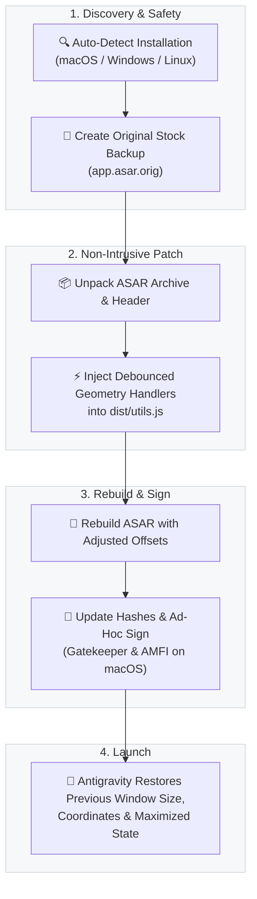

<div align="center">

# 🪟 Antigravity Window Size Persistence

**Cross-platform utility to persist and restore Google Antigravity window geometry across launches.**

[](https://github.com)
[](https://python.org)
[](https://python.org)
[](https://github.com)

<p align="center">
  <a href="#-overview">Overview</a> •
  <a href="#-how-it-works">How It Works</a> •
  <a href="#-features">Features</a> •
  <a href="#-quick-start">Quick Start</a> •
  <a href="#-cli-reference">CLI Reference</a> •
  <a href="#-restoring-factory-state">Restoration</a>
</p>

</div>

---

## 📖 Overview

By default, **Google Antigravity** resets its main window to a fixed `1400×900` resolution on every launch, ignoring custom layouts, window sizing, and multi-monitor configurations.

This utility modifies the internal `dist/utils.js` within Antigravity's `app.asar` archive to automatically persist and restore:
- 📐 **Exact window dimensions** (width and height).
- 📍 **Screen coordinates** ($x$, $y$) with intelligent multi-monitor protection.
- 🔲 **Maximized window state**.

Everything runs directly through the Python 3 standard library with **zero external dependencies** (`npm`, `pip`, or `node` are not required).

---

## ⚙️ How It Works



---

## ✨ Features

- 🖥️ **Smart Multi-Monitor Safety**: If a secondary monitor is unplugged or unavailable, the window automatically snaps back into the visible bounds of the primary active display—no off-screen windows.
- ⏱️ **Debounced State Storage**: State updates write smoothly to Antigravity's native `app_storage.json` with a 250ms debounce on `resize`, `move`, and `close` events, eliminating CPU and disk overhead.
- 🛡️ **Non-Destructive with Instant Rollback**: Creates a permanent master backup (`app.asar.orig`) plus timestamped snapshots before any modification. You can return to stock factory condition with a single command.
- 🔏 **Platform Security Compliance**:
  - **macOS**: Automatically updates the `ElectronAsarIntegrity` block in `Info.plist` and applies ad-hoc codesigning (`codesign --force --deep -s -`) to satisfy Gatekeeper and AMFI.
  - **Windows**: Handles console encoding (UTF-8), non-blocking process inspection, and atomic file replacements.
  - **Linux**: Resolves standard system paths (`/opt`, `/usr/lib`, `~/.local`) and provides clear guidance for permission handling (`sudo`).

---

## 🚀 Quick Start

Choose your operating system below:

### 🐧 Linux

Open Terminal in the repository folder:

```bash
# 1. Check current patch status
python3 patch_antigravity_window.py --status

# 2. Apply the patch (prompts if Antigravity is open)
python3 patch_antigravity_window.py

# Or apply and close running Antigravity automatically:
python3 patch_antigravity_window.py --kill
```

> [!TIP]
> You can also use the included shell runner:
> ```bash
> chmod +x run.sh
> ./run.sh --kill
> ```
> *Note: If Antigravity is installed in a system directory like `/opt/antigravity`, run with `sudo`.*

---

### 🪟 Windows

Open PowerShell or Command Prompt in the repository folder:

```powershell
# 1. Check current patch status
python patch_antigravity_window.py --status

# 2. Apply the patch (prompts if Antigravity is open)
python patch_antigravity_window.py

# Or apply and close running Antigravity automatically:
python patch_antigravity_window.py --kill
```

> [!TIP]
> You can also use the included batch or PowerShell runners:
> ```powershell
> .\run.bat --kill
> # or
> .\run.ps1 --kill
> ```

---

### 🍏 macOS

Open Terminal in the repository folder:

```bash
# 1. Check current patch status
python3 patch_antigravity_window.py --status

# 2. Apply the patch (prompts if Antigravity is open)
python3 patch_antigravity_window.py

# Or apply and close running Antigravity automatically:
python3 patch_antigravity_window.py --kill
```

> [!TIP]
> You can also use the included shell runner:
> ```bash
> chmod +x run.sh
> ./run.sh --kill
> ```

---

## 🛠️ CLI Reference

| Flag / Option | Argument | Description |
|---|---|---|
| *(none)* | — | Applies the window persistence patch to the detected installation. |
| `--status` | — | Inspects `app.asar` and displays whether the patch is active. |
| `--restore`, `--undo` | — | Restores the original stock factory `app.asar` from `app.asar.orig`. |
| `--kill` | — | Automatically closes running instances of Antigravity before patching. |
| `--app` | `<path>` | Custom path to Antigravity directory, binary executable, or `app.asar`. |

---

## 🔄 Restoring Factory State

To revert Antigravity back to stock factory condition at any time:

```bash
# Linux
python3 patch_antigravity_window.py --restore

# Windows
python patch_antigravity_window.py --restore

# macOS
python3 patch_antigravity_window.py --restore
```

---

## 💡 Official Updates

When Google releases a new version of Antigravity (e.g., via automatic background update), the installer will overwrite `app.asar`. Simply run this script again after the update to re-enable window persistence.
