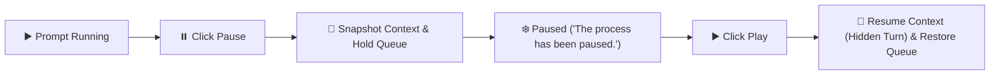

<div align="center">

# ⏯️ Antigravity Pause / Play & Window Utility

**Pause and resume live agentic prompts in Google Antigravity without losing context or queued messages — plus automatic window geometry persistence for legacy builds.**

<a href="https://github.com" target="_blank" rel="noopener noreferrer"></a>
<a href="https://python.org" target="_blank" rel="noopener noreferrer"></a>
<a href="https://python.org" target="_blank" rel="noopener noreferrer"></a>
<a href="https://comandanteamilton.com.br/" target="_blank" rel="noopener noreferrer"></a>

<p align="center">
  <a href="#-overview">Overview</a> •
  <a href="#️-pause--play-prompt-execution---add-pause">Pause / Play</a> •
  <a href="#️-how-it-works">How It Works</a> •
  <a href="#-features">Features</a> •
  <a href="#-quick-start">Quick Start</a> •
  <a href="#️-cli-reference">CLI Reference</a> •
  <a href="#️-restoring-factory-state">Restoration</a> •
  <a href="#-macos-security--keychain-notice">macOS Notice</a> •
  <a href="#-author">Author</a>
</p>

</div>

---

## 📖 Overview

When running complex agentic tasks in **Google Antigravity**, standard controls only let you **Cancel** execution or **Queue** follow-up messages — and cancelling a running prompt normally flushes or disrupts your queued workflow.

This utility enhances Google Antigravity with a dedicated **Pause / Play (`--add-pause`)** execution controller directly inside the prompt composer footer:
- ⏸️ **Pause at Any Moment**: Freezes the currently executing prompt right where it is, displaying *"The process has been paused."*
- 🛡️ **Preserves Your Queue (`Queued Messages`)**: Holds all queued prompts untouched while paused so they are not prematurely consumed or lost.
- ▶️ **Seamless Resume (`Play`)**: Continues execution from the exact point where it stopped without clearing whatever draft text you have typed in the input box, keeping the internal continuation prompt completely hidden from the session UI so the AI response flows seamlessly.
- 🪟 **Window State Persistence (Legacy Support)**: For versions prior to v2.29.0, automatically persists window dimensions, position, and maximized state (on v2.29.0+, Antigravity's native window state manager is preserved intact).

Runs standalone via Python 3 with **zero external dependencies**.

---

## ⏯️ Pause / Play Prompt Execution (`--add-pause`)

By default, the right side of Antigravity's prompt box shows either **`Cancel`** (when the input box is empty) or **`Queue message`** (when you have typed a follow-up prompt).

With `--add-pause`, a contextual third button is injected right beside `Queue message` / `Cancel`:

1. **Displayed Exclusively When Needed**:
   - Hidden when the session is idle.
   - Appears as **`Pause`** (amber) exclusively while a prompt is actively executing.
   - Switches to **`Play`** (emerald, with a counter badge if queued messages are held) while paused.
2. **In-Flight Context & Queue Snapshot on `Pause`**:
   - Captures any in-flight partial reasoning/response from the active `trajectorySlice` before halting the invocation.
   - Snapshots and holds all pending items in `Queued Messages` (`WHEN_IDLE`) so the backend does not auto-fire them while you are paused.
   - Replaces the default cancellation text with **`The process has been paused.`**
3. **Zero-Friction Resume on `Play`**:
   - Dispatches an internal US English continuation instruction (`NEXT_INVOCATION`) via the non-composer channel so **your current input draft is never cleared**.
   - Automatically hides the internal continuation prompt and intermediate turn dividers from the conversation UI, merging the resumed output into a continuous visual response.
   - Re-queues all held `Queued Messages` (`WHEN_IDLE`) in their exact original order as soon as execution resumes.

---

## ⚙️ How It Works



---

## ✨ Features

- ⏯️ **Pause & Resume Agentic Prompts (`--add-pause`)**: Pause active executions, inspect intermediate changes, and resume with one click without losing context.
- 📥 **Queue Preservation**: Protects `Queued Messages` (`WHEN_IDLE`) across pauses and automatically restores them in order after resuming.
- 👻 **Clean Session UI**: Hides internal resume prompts from the chat timeline and replaces *"User cancelled agent execution."* with *"The process has been paused."*
- 🔄 **Seamless App Updates (`--update`)**: Installs new official Google releases and automatically reapplies your active patches (`--add-pause` and/or window persistence).
- 🚀 **Self-Updating (`--selfupdate`)**: Pulls the latest version of this tool directly from GitHub.
- 🛡️ **Intelligent Downgrade Guard**: Tracks version and SHA-256 ASAR hashes to prevent `--restore` from downgrading your app after an official update.
- 🐧 **Linux Desktop Integration**: Automatically generates `.desktop` shortcuts with the official icon for the system application menu.
- 🪟 **Legacy Window Geometry Persistence**: Automatically saves and restores window size, multi-monitor coordinates, and maximized state on Antigravity versions `< v2.29.0` (while keeping native `windowState.js` intact on `v2.29.0+`).

---

## 🚀 Quick Start

Run from your terminal (use `python` on Windows, `python3` on macOS/Linux):

```bash
# Enable the Pause/Play prompt button (and close Antigravity automatically to apply):
python3 patch_antigravity_window.py --add-pause --kill

# Or apply interactively (prompts if Antigravity is running):
python3 patch_antigravity_window.py --add-pause

# Check current patch & version status:
python3 patch_antigravity_window.py --status
```

> [!TIP]
> **Convenience runners:**
> - **Linux / macOS**: `./run.sh --add-pause --kill` *(use `sudo ./run.sh` only if installed in a system directory like `/opt`)*
> - **Windows**: `.\run.bat --add-pause --kill` *(or `.\run.ps1 --add-pause --kill` in PowerShell)*

---

## 🛠️ CLI Reference

| Option | Argument | Description |
|---|---|---|
| `--add-pause` | — | **Recommended:** Injects or updates the contextual `Pause` / `Play` button next to `Queue message` / `Cancel` to pause and resume running prompts while preserving queued messages. |
| *(none)* | — | Applies legacy window geometry persistence (on `< v2.29.0`) or checks native window state support (`v2.29.0+`). |
| `--status` | — | Displays current status of the `Pause / Play` button, window persistence, and pending official updates. |
| `--update` | — | Installs pending official updates downloaded by Antigravity and automatically re-applies active patches. |
| `--selfupdate` | — | Updates `Antigravity-IDE-WindowSize` itself to the latest version from GitHub. |
| `--restore`, `--undo` | — | Restores the stock factory `app.asar` from backup. |
| `--force`, `--force-restore` | — | Overrides the downgrade protection and forces restoration even if an official update was detected. |
| `--kill` | — | Automatically terminates Antigravity if currently running before patching or updating. |
| `--shortcut` | — | Creates or refreshes the Linux desktop shortcut (`.desktop`) and application menu entry. |
| `--app` | `<path>` | Custom path to Antigravity folder, executable, or `app.asar`. |
| `-v`, `--version` | — | Shows program version number and exits. |

---

## 🔄 Updates Workflow

### Updating Antigravity IDE
When Google releases a new version, Antigravity downloads it in the background. Because packaged modifications disable in-app restarts on macOS, simply run:

```bash
# macOS / Linux:
./run.sh --update --add-pause --kill

# Windows:
.\run.bat --update --add-pause --kill
```
*(Note: If `--add-pause` was already active before the update, `--update` automatically detects and preserves it even without passing `--add-pause` again.)*

### Updating This Tool
To pull the latest version of `patch_antigravity_window.py` from GitHub:

```bash
python3 patch_antigravity_window.py --selfupdate
# or ./run.sh --selfupdate (Windows: .\run.bat --selfupdate)
```

---

## ↩️ Restoring Factory State

To revert Antigravity back to stock factory condition at any time:

```bash
python3 patch_antigravity_window.py --restore
# Windows: .\run.bat --restore
```

> [!NOTE]
> **Intelligent Downgrade Guard:**
> If Antigravity was updated by Google after the patch was applied, the script prevents `--restore` from overwriting your new version with an obsolete backup. Pass `--force` only if you explicitly want to override this guard.

---

## 🍎 macOS Security & Keychain Notice

When modifying `app.asar` on macOS, the original signature is replaced with an ad-hoc signature (`codesign -s -`) to satisfy Gatekeeper and AMFI.

On the first launch after patching, macOS may prompt you once:
> *"Antigravity wants to access key '...' in your keychain. Enter your login password to allow."*

Select **"Always Allow"** to proceed normally. Since macOS binds Keychain entries to binary signatures, this prompt is expected.

<p align="left">
  <a href="https://antigravity.google/download" target="_blank" rel="noopener noreferrer">
    
  </a>
</p>

---

## 👤 Author

**Amilton Camargo Junior (Comandante)**
- 🌐 Website: <a href="https://comandanteamilton.com.br/" target="_blank" rel="noopener noreferrer">comandanteamilton.com.br</a>
