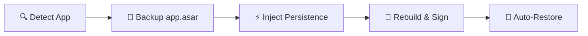

<div align="center">

# 🪟 Antigravity Window Size Persistence

**Cross-platform utility to persist and restore Google Antigravity window geometry across launches.**

[](https://github.com)
[](https://python.org)
[](https://python.org)
[](https://comandanteamilton.com.br/)

<p align="center">
  <a href="#-overview">Overview</a> •
  <a href="#-how-it-works">How It Works</a> •
  <a href="#-features">Features</a> •
  <a href="#-quick-start">Quick Start</a> •
  <a href="#-cli-reference">CLI Reference</a> •
  <a href="#-restoring-factory-state">Restoration</a> •
  <a href="#-author">Author</a>
</p>

</div>

---

## 📖 Overview

By default, **Google Antigravity** resets its window to `1400×900` on launch. This utility modifies `dist/utils.js` inside `app.asar` to automatically persist:
- 📐 **Dimensions** (width and height).
- 📍 **Position** ($x$, $y$) with off-screen multi-monitor safety.
- 🔲 **Maximized state**.

Runs standalone via Python 3 with **zero external dependencies**.

---

## ⚙️ How It Works



1. **Auto-detects** Antigravity on macOS, Windows, or Linux.
2. **Backs up** original `app.asar` (`app.asar.orig`).
3. **Injects** debounced window geometry handlers into `dist/utils.js`.
4. **Restores** your exact window layout on every launch.

---

## ✨ Features

- 🖥️ **Multi-Monitor Safe**: If a display is disconnected, the window shifts safely to an active screen.
- ⏱️ **Debounced Saving**: Geometry writes to native `app_storage.json` without lag (250ms debounce).
- 🛡️ **Reversible**: Master backup created automatically before patching. Revert anytime with `--restore`.
- 🔏 **Platform Compliant**: Handles macOS `codesign`/`ElectronAsarIntegrity`, Windows paths, and Linux permissions.

---

## 🚀 Quick Start

Run from your terminal (use `python` on Windows, `python3` on macOS/Linux):

```bash
# Check current status
python3 patch_antigravity_window.py --status

# Apply the patch (prompts if Antigravity is running)
python3 patch_antigravity_window.py

# Or apply and close Antigravity automatically:
python3 patch_antigravity_window.py --kill
```

> [!TIP]
> **Convenience runners:**
> - **Windows**: `.\run.bat --kill` *(or `.\run.ps1 --kill` in PowerShell)*
> - **Linux / macOS**: `./run.sh --kill` *(use `sudo ./run.sh` only if installed in a system directory like `/opt`)*

---

## 🛠️ CLI Reference

| Option | Argument | Description |
|---|---|---|
| *(none)* | — | Applies the persistence patch to the detected installation. |
| `--status` | — | Checks if the patch is active on `app.asar`. |
| `--restore`, `--undo` | — | Restores the stock factory `app.asar` from backup. |
| `--kill` | — | Terminates Antigravity if currently running before patching. |
| `--app` | `<path>` | Custom path to Antigravity folder, executable, or `app.asar`. |

---

## 🔄 Restoring Factory State

To revert Antigravity back to stock factory condition at any time:

```bash
python3 patch_antigravity_window.py --restore
```
*(On Windows, run `python patch_antigravity_window.py --restore` or `.\run.bat --restore`)*

---

## 💡 Official Updates

When Google updates Antigravity, the updater overwrites `app.asar`. Simply re-run this script to reapply persistence.

<p align="left">
  <a href="https://antigravity.google/download">
    
  </a>
</p>

---

## 👤 Author

**Amilton Camargo Junior (Comandante)**
- 🌐 Website: [comandanteamilton.com.br](https://comandanteamilton.com.br/)
